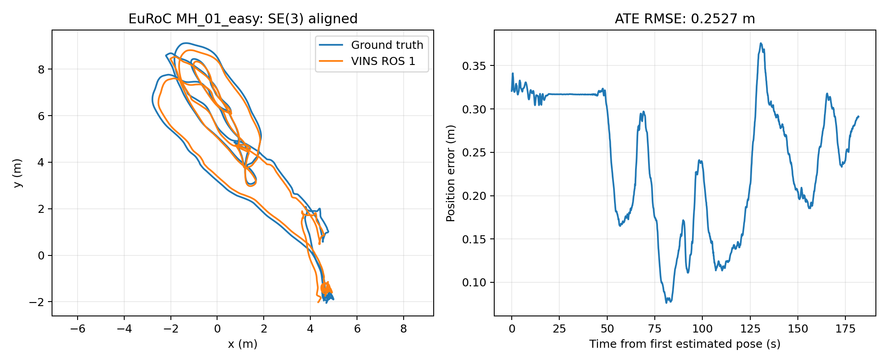

# 原生 Ubuntu 22.04 ROS 1 参照

日期：2026-10-13

本报告已替换为当前物理主机的实测。Ubuntu 22.04.5、Linux 6.8.0-138-generic、Ryzen 7 9800X3D；ROS Noetic 与 C++ 依赖隔离，OpenCV 4.2.0 / Ceres 1.14.0 从源码重建。源码参照为 master `f85e0f1`，VINS 算法、标定和参数未修改

MH_01_easy 双目 IMU、开环 VIO；每轮完整 1 倍目标回放，输入为 3682 对图像和 36820 条 IMU，bag SHA256 为 `57f440ccd68ec8dc8f9461269f5909656b86198bac3adfd677b1fcc7a1428fa9`

| 实验 | poses / 真值匹配 | ATE RMSE (m) | 相邻位姿 RPE RMSE (m) | VINS CPU (s) |
| --- | ---: | ---: | ---: | ---: |
| native_MH01_baseline_r01 | 1831 / 1819 | 0.252745 | 0.003083 | 163.33 |
| native_MH01_baseline_r02 | 1831 / 1819 | 0.252745 | 0.003083 | 163.50 |
| native_MH01_metrics_r01 | 1831 / 1819 | 0.252745 | 0.003083 | 163.91 |
| native_MH01_metrics_r02 | 1831 / 1819 | 0.252745 | 0.003083 | 163.31 |

四轮使用同一个二进制，均初始化一次、无重置或配对丢弃，轨迹覆盖末帧。evo 以 IMU/body 真值作 SE(3) 对齐，不校正尺度；真值时间略短于末尾，匹配率约 99.34%。RPE 为相邻位姿间隔，约 0.1 秒

回放进程均退出 0，VINS 清理均退出 −6：原版同步线程未 join 的 abort 仍保留，不能把功能完整性验收称为干净退出或长期稳定性通过。ROS 1 未添加回调计数器，输入计数为 bag 记录，不能声明每个消费端回调都已计数

CPU 为 VINS 全部线程累计秒，RSS/PSS 各轮峰值、回放/排空及失败记录统一见 [第 05 份报告](05_EUROC_ROS1_ROS2_COMPARISON.md)。外部 rosbag 与 roscore 未纳入本次资源表，不能用 VINS 数值代表整条链或全机

[本机证据与 SHA256](../infra/desktop/comparison_reference/native_ubuntu22_20261013/ros1/)包含配置、轨迹、评估、逐秒资源和验收摘要；完整日志在 `../results/ros1/`。历史 WSL 报告可从 `baseline-ros1-euroc-v1` 查阅，旧归档与冻结哈希保持原样

新 annotated tag 为 `baseline-ros1-native-ubuntu22-v1`，提交位于 master。后续步骤见 [复现清单](07_NATIVE_UBUNTU_REPRODUCTION.md)，环境入口见 [搭建说明](02_UBUNTU22_ROS1_SETUP.md)
