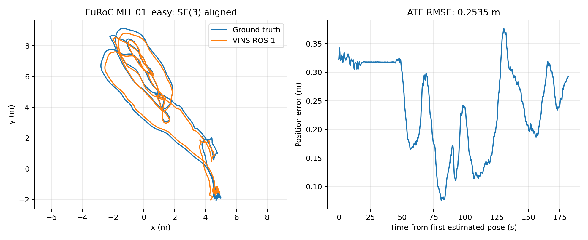

# VINS-Fusion / Ubuntu 22.04 原版参照实测报告

日期：2026-10-09

源码：`be55a937a57436548ddfb1bd324bc1e9a9e828e0`，原算法源码未修改；仓库新增环境设施和文档。

环境：工程内 ROS Noetic / OpenCV 4.2.0 / Ceres 1.14.0；Python 评估由 uv 管理。

模式：原版 EuRoC 双目 IMU VIO；无回环；原算法参数与 MEI 标定保持不变。

## 数据与评估

数据：MH_01_easy；3682 对图像、36820 条 IMU；双目 header 时间跨度 184.05 s。

bag SHA256：`57f440ccd68ec8dc8f9461269f5909656b86198bac3adfd677b1fcc7a1428fa9`。

真值：OpenVINS 保存的 EuRoC IMU/body 状态 CSV，校验值见 [baseline-assets.sha256](../infra/desktop/baseline-assets.sha256)。

评估：evo，SE(3) 对齐，尺度固定 1，最大匹配差 0.01 s。

## 实测结果

| 实验 | poses | 匹配率 | ATE RMSE (m) | 相邻位姿 RPE RMSE (m) | RSS 采样峰值 (MiB) |
| --- | ---: | ---: | ---: | ---: | ---: |
| [MH_01_easy_run1](../infra/desktop/baseline_reference/MH_01_easy_run1/) | 1831 | 99.34% | 0.253458 | 0.003085 | 74.84 |
| [MH_01_easy_run2](../infra/desktop/baseline_reference/MH_01_easy_run2/) | 1831 | 99.34% | 0.252677 | 0.003083 | 76.99 |

两轮均以 1 倍速完整回放；播放进程退出 0；节点在回放期间持续运行。
轨迹均覆盖最后一帧图像；日志未见双目配对丢弃或 failure detection。

匹配率不足 100% 的部分主要位于状态真值未覆盖的序列末尾，不等同输入丢帧。
ATE 为本机原配置参照，不是跨平台性能结论；两轮不足以建立统计容差。
相邻位姿 RPE 的间隔约 0.1 s，不是固定 1 s 的误差。

## 原版行为与复现入口

原版生命周期缺陷：清理时未 join 的 sync_thread 触发 terminate/abort，vins 退出 -6。
完整回放成功与清理退出状态分别记录，未修改原版来隐藏此问题。

小体积参照快照：[baseline_reference/](../infra/desktop/baseline_reference/)，包含轨迹、配置、评估、环境、校验清单。

全部原始实验日志：运行工作区内的 `results/ros1/MH_01_easy_run1` 和 `MH_01_easy_run2`，不纳入 Git。

环境重建说明：[Ubuntu 22.04 搭建说明](UBUNTU22_ROS1_BASELINE_SETUP.md)。

后续迁移使用相同数据/配置进行 A/B；先扩大原版重复和序列，再确定精度容差。
